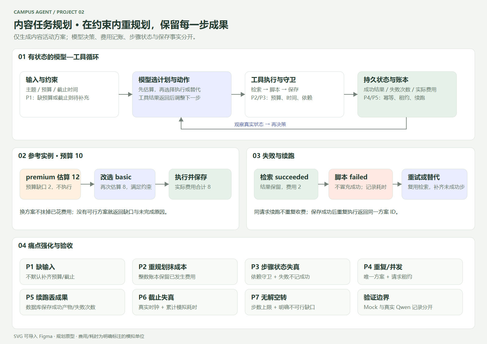

# 题目 2：内容任务规划 Agent

## 固定版本交付（2026-11-07）

[设计说明](docs/submission/01-design.md) · [提交与考官验收指南](docs/submission/02-delivery-and-acceptance.md) · [干净源码包检查](examples/submission/preflight.json)。固定标签 `q2-submission-20261107`；公开仓库和本机Ollama均无需评审密钥。完整提交SHA以该标签指向commit为准。


在预算与截止时间内生成内容活动方案。模型根据工具观察重规划，持久化成功步骤并支持失败续跑。

入口为 CLI 和本地 Web。仅生成并保存方案，不执行真实投放、购买或发布。

## 评审入口

- [本轮边缘与困难场景修复](docs/09-hardening-round.md)：修复前失败、原因、修复后回归与真实模型补测。

- [需求与验收点](docs/01-requirements.md)、[动作流与设计取舍](docs/02-solution.md)。
- [实际验证与失败记录](docs/03-evaluation.md)、[分层稳健性检查](docs/08-robustness.md)。
- [AI 使用范围](docs/04-ai-usage.md)、[复盘与实际用时](docs/05-retrospective.md)。
- [使用手册](docs/07-user-manual.md)、[Figma 可导入 SVG](docs/prototypes/planning-flow.svg)。
- [最终证据核查](examples/acceptance.json)、[真实预算重规划](examples/real/reference/)、[真实故障重规划复测](examples/real-tool-retest/)、[离线验收证据](examples/mock/acceptance.json)、[浏览器检查](examples/browser/report.json)、[可执行测试结果](examples/tests/report.json)。



## 环境与安装

Python 3.10+，应用运行时仅使用标准库，无第三方 Python 依赖。Windows 验证版本为 Python 3.10.11；GitHub Actions 同时检查 3.10/3.12。Node.js 22+ 仅用于可选的浏览器测试。没有依赖 Agent 框架；状态机、SQLite 事务和模型循环都是本仓库代码。

```powershell
git clone https://github.com/ttk-maker/campus-agent-q2-content-planning.git
cd campus-agent-q2-content-planning
py -3.10 -m src.web
```

打开 **http://127.0.0.1:8767/**，使用手册在 **http://127.0.0.1:8767/manual.html**。Linux/macOS 将下列命令中的 `py -3.10` 换成 `python3`。默认数据库 `runtime/workbench.db`，可用 `--db` 指定；`--port` 可更改端口。HTTP 服务只绑定本机。

`http://localhost:11434/v1` 是 Ollama 的模型 API 前缀，直接浏览可能 404；它不是工作台页面。GitHub 是源码交付，未托管在线应用。

## CLI 离线运行与续跑

```powershell
py -3.10 -m scripts.make_request --scenario reference
py -3.10 -m src.cli --request runtime/request/input.json --catalog runtime/request/catalog.json --db runtime/cli.db --mode mock
# 原命令再执行：同一方案 ID、零新增费用
py -3.10 -m src.cli --request runtime/request/input.json --catalog runtime/request/catalog.json --db runtime/cli.db --mode mock
```

`make_request` 创建新 ID 和未来一天的截止时间。`data/requests/reference.json`、`examples/` 是历史实测输入，不要把其中已过期的截止时间直接当成今天的新任务。

验证失败续跑：把 `--scenario reference` 改为 `--scenario resume`，首次运行返回 `failed`、费用 2；**不要重新生成输入**，执行同一 CLI 命令，下一次完成且总费 8。数据库跨进程保留成功检索、失败次数和费用。

CLI 默认写 `runtime/output.json` 和 `runtime/trace.jsonl`，可用 `--output` / `--trace` 指定位置。完成返回退出码 0，待补信息、无可行方案、失败、步数用尽返回 2。单次最多 16 个模型动作，可用 `--max-steps 1..100` 调整。

## 真实模型

本机实际使用 Ollama + `qwen2.5:7b-instruct`（7B Q4_K_M），无需 API Key。先安装 Ollama 并运行：

```powershell
ollama pull qwen2.5:7b-instruct
$env:MODEL_BASE_URL='http://localhost:11434/v1'
$env:MODEL_NAME='qwen2.5:7b-instruct'
py -3.10 -m scripts.make_request --scenario reference
py -3.10 -m src.cli --request runtime/request/input.json --catalog runtime/request/catalog.json --db runtime/real.db --mode real
```

网页服务默认采用上述本地端点和模型，CLI 需要显式环境变量。`.env.example` 是配置说明，程序不自动加载 `.env`。远程服务需支持 Chat Completions 的 JSON Schema 结构化输出，并使用 HTTPS 及自己授权的 `MODEL_API_KEY`，从环境传入；不提交真实密钥。

每次模型选择一个 JSON 动作，工具执行后的真实状态和观察摘要回到模型，再决定换计划、重试或结束。单次 HTTP 超时 90 秒；CPU 推理可能持续数分钟。模型上下文只保留最近两次观察摘要及最新持久状态，完整产物保存在 SQLite 与 Trace。Mock 使用固定策略，仅验证流程，不证明真实决策效果。素材检索和脚本工具也是明确标注的本地合成工具。

## 费用、依赖与幂等

| 工具 | 模拟费用 | 模拟分钟 |
| --- | ---: | ---: |
| 素材检索 | 2 | 3 |
| 高级 / 基础脚本 | 8 / 4 | 20 / 8 |
| 成本估算 | 0 | 1 |
| 方案保存 | 2 | 2 |
| 失败尝试 | 0 | 1 |

参考预算 10：估算高级 12 → 模型改选基础 → 再估算 8 → 检索 → 脚本 → 保存。估算是工具观察；付费执行前守卫重算预算和截止时间，模型不能改变硬约束。内部用整数分精确记账。已花费用始终保留，即使换套餐放弃产物也不能抹掉成本。

同一 `request_id` 的主题、预算、截止时间和工具目录必须保持一致；修改后使用新 ID。已成功步骤不重复执行，保存表使用唯一键，跨进程租约防同键并发。失败可以续跑；所有历史尝试保存在费用事件中，不能将失败伪装成成功。

整体状态与实际保存状态独立：若已保存但下一次模型请求失败或达到步数上限，整体仍明确未完成，同时展示真实的 `save_status=saved`。重复运行读取已保存方案并完成，不重复收费。

## 验证命令

```powershell
py -3.10 -m scripts.test_report
py -3.10 -m scripts.evaluate --output runtime/check-mock
py -3.10 -m scripts.evaluate --mode real --output runtime/check-real --cases reference tool_failure over_budget missing
```

离线八类场景共 11 次运行，覆盖所有必验及续跑。真实证据、调试时的失败与修复边界详见评估文档。重跑写入 `runtime/`，避免覆盖提交的历史证据。

可选浏览器检查（另一个终端启动测试服务）：

```powershell
npm ci
npx playwright install chromium
py -3.10 -m src.web --port 8768 --db runtime/browser.db
# 新终端，在仓库目录
npm run test:browser
```

测试默认访问 8768，生成 `examples/browser/` 证据；可通过 `WEB_URL` / `BROWSER_OUTPUT` 修改。真实网页联调脚本为 `node scripts/browser-real.cjs`，需要已启动本地模型。CI 运行 Python 与离线浏览器验证，不会伪装具有真实模型服务。

## 已知边界

单机演示服务，无多租户权限、真实采购或内容质量评测；工具成功费/失败零费是本项目合成规则，不代表真实服务计费。SQLite 事务能覆盖本地模拟副作用；真实外部服务仍需幂等键及对账。Web 最近 100 次运行记录在内存中，重启会清空；业务结果、步骤和账本仍在数据库，Trace 应及时导出。真实模型样本量有限，不宣称所有输入均能正确规划。


## 前端优化与复用 Skill

[四向优化记录](docs/10-ui-refinement.md) · [frontend-four-pass Skill](docs/skills/frontend-four-pass/SKILL.md) · [展示检查](examples/ui-refinement/presentation/report.json)。本轮只调整展示与信息层级，后端及模型逻辑保持不变。


## 实时调参与显示设置

结果画布 + 参数侧栏，支持业务输入预览和主题色 / 明暗 / 字号 / 密度 / 动效设置。外观即时生效，Agent 仍由原运行按钮显式执行。

[使用说明与设计边界](docs/11-live-tweaks.md) · [交互验证](examples/tweaks/interaction/report.json) · [新版截图](examples/tweaks/interaction/success-desktop.png)
